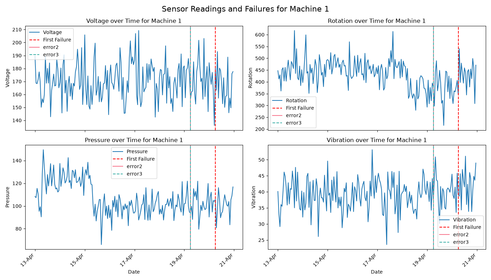
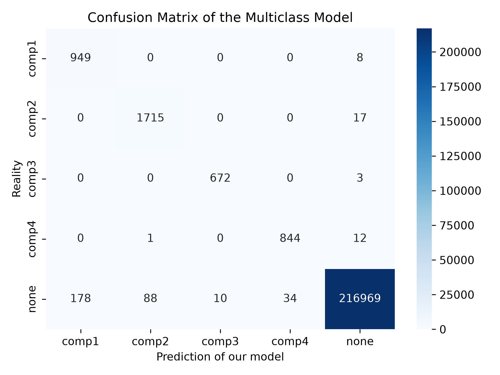
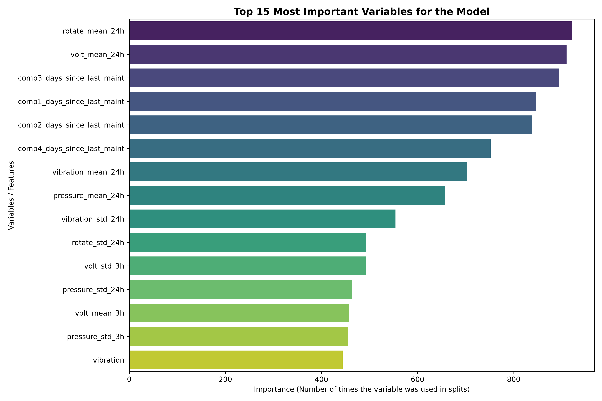
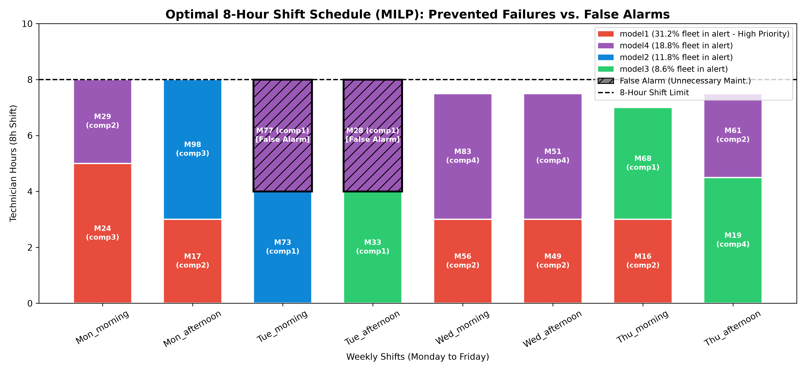
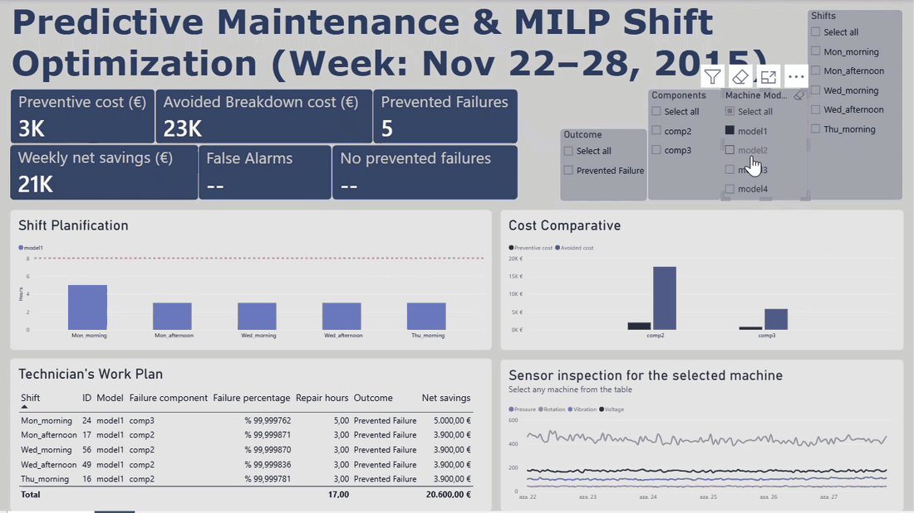

# Predictive Maintenance, Optimization and AI Copilot
## 1. Aims and goals
In this project, we aim to develop a predictive maintenance system for industrial machines using historical data on failures, errors and sensor readings.

In an industrial environment, there are different approaches to machine maintenance. One of them is reactive maintenance, which involves replacing or repairing a component only after it has failed. Although this approach avoids unnecessary maintenance, it can lead to high costs when unexpected breakdowns occur, especially if they interrupt the production process.

Another approach is preventive maintenance, which consists of replacing components at regular time intervals, regardless of their actual condition. However, this approach is not always efficient, as some components may still be in good condition when they are replaced, resulting in unnecessary costs and wasted resources.

It is also important to consider the age and condition of each machine. A new machine will generally behave differently from one that has been operating for 15 years. As machines get older, their components may become more likely to fail due to wear and tear.

Therefore, the main goal of this project is to predict machine failures 24–48 hours in advance. This would allow maintenance teams to identify potential problems early and take action before a breakdown occurs, reducing unexpected downtime and maintenance costs.

## 2. Dataset and Data Architecture
The dataset used in this project comes from *Kaggle* and is called [Microsoft Azure Predictive Maintenance
](https://www.kaggle.com/datasets/arnabbiswas1/microsoft-azure-predictive-maintenance/data).

It consists of five different datasets containing information about 100 machines throughout 2015. The datasets provide several types of information about the machines and their operating conditions.

First, we have information about the errors reported by each machine, including when each error occurred and its type. There are five different types of errors. We also have information about machine failures, including when they occurred and their corresponding type. The dataset includes four different types of failures.

In addition, we have general information about each machine, such as its model (four distinct models) and age. There is also maintenance information, which records when each of the four components was replaced in each machine.

Finally, the dataset includes sensor readings collected every hour from each machine. These readings contain four measurements: voltage, rotation speed, pressure and vibration.

With all this information, we can start performing exploratory data analysis and developing predictive models.

### 2.1. First analysis
The first step was to create a [relational database in SQL](src/create_db.py), where we stored all five CSV files. The aim was to simulate a real-world environment in which data is collected and retrieved from a database.

To better understand the information available in the database, we also developed several [SQL queries](sql/analytical_queries.sql) to explore its main characteristics and identify potential patterns. These queries were executed using this [Python script](src/execute_sql.py).
#### Average time between failures
The first analysis focuses on calculating the average number of days since the last failure for each machine model and age group. Due to the large amount of results, the complete tables can be found in this [Markdown file](reports/avg_days_tab.md). 

Overall, we cannot identify a clear pattern across all machine models. However, we can observe that the differences become more noticeable when machines reach approximately 10 years of age. From this point onwards, the average number of days between failures tends to decrease.

For example, Model 1 shows relatively small differences across the different age groups. Model 2 presents more noticeable variations, while Models 3 and 4 show the largest differences. In these two models, the average time between failures can decrease by approximately 50% when machines are older than 10 years.

Finally, it is worth highlighting an unusual pattern in Models 1 and 2. In these cases, machines experience more frequent failures during their first years of operation than when they reach approximately 8–10 years of age. This behaviour is particularly interesting, as it does not follow the expected pattern of an increasing failure rate as machines get older.

#### Sensor measurements before a failure
Furthermore, we have calculated the average and standard deviation of all sensor measurements during the 24 hours preceding a failure. Table 1 summarises these results for all machines throughout 2015.

**Table 1. Averages and standard deviations of each measurement.**
| failure   |   avg_voltage |   stddev_voltage |   avg_rotation |   stddev_rotation |   avg_pressure |   stddev_pressure |   avg_vibration |   stddev_vibration |
|:----------|--------------:|-----------------:|---------------:|------------------:|---------------:|------------------:|----------------:|-------------------:|
| comp1     |       190.928 |          15.6381 |        443.006 |           54.8134 |        101.517 |           12.0876 |         40.5166 |            5.55886 |
| comp2     |       171.181 |          15.68   |        368.775 |           51.3173 |        101.524 |           11.6895 |         40.7979 |            5.82093 |
| comp3     |       171.424 |          16.3476 |        443.289 |           54.8455 |        125.492 |           10.5173 |         40.4279 |            5.35771 |
| comp4     |       170.921 |          15.8809 |        441.276 |           56.4372 |        101.204 |           11.7264 |         50.3868 |            5.43473 |
| Total     |       170.778 |          15.5091 |        446.605 |           52.6739 |        100.859 |           11.0487 |         40.385  |            5.37036 |

The results show some interesting differences between machine components. Although the standard deviations do not vary significantly, the average values reveal some clear changes in sensor measurements before a failure. More specifically, each machine component seems to have one particular measurement that behaves differently during the 24 hours preceding a failure:

- Component 1: Voltage tends to be higher.
- Component 2: Rotation speeds tend to be lower.
- Component 3: Pressure tends to be higher.
- Component 4: Vibration tends to be higher.

These results suggest that certain sensor measurements could be useful indicators of potential machine failures. In other words, monitoring these variables could help us identify abnormal machine behaviour and detect possible failures before they occur.

This is particularly relevant for our predictive maintenance system, as these measurements could be used as input features for the predictive models.

#### Relationship between errors and subsequent failures

Finally, we have analysed the percentage of failures that occur within 48 hours after an error is reported. The results can be found in Table 2.

**Table 2. Percentage of failures 48h after an error.**

| errorID   |   total_errors |   followed_by_failure |   pct |
|:----------|---------------:|----------------------:|------:|
| error1    |           1010 |                   215 | 21.29 |
| error2    |            988 |                   281 | 28.44 |
| error3    |            838 |                   289 | 34.49 |
| error4    |            727 |                   155 | 21.32 |
| error5    |            356 |                   183 | 51.4  |

Table 2 reveals some interesting differences between error types. Error 1 is the most frequently reported error. However, only 21% of the machines experiencing this error have a failure within the following 48 hours. This percentage is relatively low and is similar to the results obtained for Error 4.

On the other hand, Error 5 presents a much higher risk. Approximately 50% of the machines reporting this error experience a failure within the next 48 hours. This suggests that Error 5 is a much stronger indicator of an upcoming failure than Errors 1 or 4.

These results allow us to establish a priority level for the different error types when planning maintenance operations. Instead of treating all errors equally, we could give greater attention to those that are more frequently followed by a failure.

For example, when Error 5 is reported, the maintenance team should consider giving the affected machine a higher priority and carrying out an inspection as soon as possible. In contrast, Errors 1 and 4 could initially receive a lower priority, although they should still be monitored.

This approach could help maintenance teams use their resources more efficiently, focusing their attention on machines with a higher risk of failure. It could also reduce unnecessary inspections and help prevent unexpected breakdowns.

However, these percentages should be interpreted carefully. A high percentage of failures after a particular error does not necessarily mean that the error directly causes the failure. Therefore, these results should be combined with sensor measurements, machine age and other available information to obtain more reliable predictions.

## 3. Visual Inspection and Feature Engineering
### 3.1. Visual inspection of a failure (Machine 1)

We also wanted to understand how a machine behaves in the hours and days leading up to a failure. In Figure 1, we can see the evolution of all sensor measurements before a failure occurs in Machine 1.

It is important to mention that this is not the first failure recorded for this machine. The first two failures occurred within the first seven days, and since we wanted to analyse a seven-day time window, we decided to use the third failure instead.



Figure 1 shows all the sensor measurements during the seven days preceding the failure, as well as the measurements recorded on the following day. It also includes the errors reported by the machine during this period. In this particular example, Errors 2 and 3 occur at almost the same time, shortly before the failure.

As we can observe, the hourly frequency of the sensor readings creates a considerable amount of variation in the measurements. For example, there is a significant decrease in voltage approximately one hour before the failure occurs. We can also observe a decrease in rotation speed a few hours before the failure. This is particularly interesting because, in our previous analysis, we found that lower rotation speeds were commonly associated with failures in Component 2, and taking a look at the [failures](data/failures.csv) file, we see that the broken component is indeed the second one.

The other two measurements, pressure and vibration, remain relatively stable, without any particularly significant peaks or changes.

This example highlights an important aspect of predictive maintenance: looking at a single sensor measurement at a specific point in time is not enough to reliably predict a failure. Instead, we need to consider the recent trends, variations and historical behaviour of the machine. By analysing how measurements evolve over time, rather than focusing only on individual values, we may be able to identify patterns that indicate an upcoming failure.

### 3.2. Feature engineering (Building the model dataset)
The next step is to transform all the information we have collected into a single dataset that can be used to train our predictive models.

Using the code in our [notebook](notebooks/eda_and_features.ipynb), we have combined the five SQL tables into one dataset. This process has been challenging because the different sources contain information recorded at different time intervals: hourly sensor readings, occasional errors, failures and maintenance operations.

To train a predictive model, we need all this information to follow the same time scale. Therefore, we have created a dataset with one observation for each `machineID` and `datetime`, representing each individual machine hour.

During this process, we have applied several transformations to create new variables (features) that we believe could be useful for the model:

1. **Rolling windows on sensor readings (3h and 24h):** We have calculated the mean and standard deviation of each sensor measurement over rolling windows of 3 and 24 hours. The 3-hour window is intended to capture sudden changes in machine behaviour, while the 24-hour window helps identify longer-term trends and variations. Each hourly observation therefore includes the mean and standard deviation of the sensor measurements over both time windows.

2. **Error accumulation in the last 24 hours:** Instead of simply checking whether an error occurs at a specific moment, we have calculated the number of errors reported by each machine during the previous 24 hours. This allows the model to consider recent error history and identify whether a machine has experienced any problems shortly before a potential failure.

3. **Time since last component replacement:** For each hourly observation, we have calculated the number of days each component has been operating since its last replacement. This information allows us to take into account the maintenance history and the age of each component.

4. **Machine metadata integration:** Finally, we have added general information about each machine, including its model and age. This allows the model to consider differences between machines and their operating conditions.

The final result is a dataset, [features](data/features.csv), containing 876,000 observations (8,760 hours in 2015 for each of the 100 machines) and 33 variables.
This dataset provides a common structure for all the information collected throughout the project. It is now ready for the next step: creating the target variable and training our predictive models.

## 4. Target Definition and Model Training
### 4.1. Target definition
After creating all the explanatory variables, the final step in preparing our dataset is to add the target column that we want to predict. Specifically, we want to know whether a machine will experience a failure within the next 24 hours and, if so, which component will fail.

Instead of a simple binary classification, we frame this as a multiclass classification problem with five possible states, depending on which component breaks: `comp1`, `comp2`, `comp3` or `comp4`. If no component fails within the following 24 hours, the observation is labelled as `none`.

In a few cases, more than one component fails within the same 24-hour window. When this happens, we keep the first failure that occurs. Combining multiple simultaneous failures into separate classes could be explored in future updates, but keeping the five main states makes the model much cleaner and easier to interpret.

With this target variable added, our [`features.csv`](data/features.csv) dataset is complete and ready for modelling.

### 4.2. Model training
Now that we have all the variables needed to predict upcoming failures, we train and evaluate our model in this [Jupyter Notebook](notebooks/model_training.ipynb) following several steps.

#### 4.2.1. Train/Test split
We split the dataset into 75% for training and 25% for testing. However, because we are working with time series data, we cannot split the observations randomly.

A random split would break the temporal order of the data and leak information from the future into the past, especially since our variables use 24-hour rolling windows. What we really want is to see if the model can learn from past months and accurately predict failures in future months.

Therefore, we use all observations from January 1st to September 30th as our training set, and the remaining three months, from October 1st to December 31st, as our test set.

#### 4.2.2. LightGBM configuration
For training, we use the `LightGBM` algorithm (`LGBMClassifier`), as it performs very well on tabular data and trains quickly even with hundreds of thousands of observations.

Since we are predicting five possible states, we set `num_class = 5`. In addition, we include a key parameter in the model: `class_weight = 'balanced'`.

Without this parameter, the predictions would be poor. Because machines operate normally (`none`) around 98% of the time, a standard model could simply predict "no failure" for every single hour and still achieve 98% accuracy. In practice, that would be useless: every undetected failure leads to high production costs and unexpected machine downtime. Our real goal is not just high overall accuracy, but catching the actual failures. Setting `class_weight = 'balanced'` forces the model to give equal importance to all five states and pay special attention to the failure classes.

#### 4.2.3. Model performance and evaluation
Once the model is trained, we can evaluate its predictions on the test set (October to December) in two complementary ways.

First, the confusion matrix in Figure 2 shows how many observations are correctly classified on the main diagonal, and where the model makes mistakes when it misclassifies an observation.



Looking at Figure 2, the first thing that stands out is that almost all predictions fall along the diagonal, which is a great sign. Beyond the diagonal, the most critical part of this matrix from a business perspective is the last column (`none`). Numbers in that column (outside the bottom-right corner) represent hours where a real component failure was about to happen, but the model predicted `none`. Those missed failures are the most expensive mistakes because they lead to unexpected breakdowns and production stops.

Fortunately, those numbers are very small, around 1% of the failures for each component, and only slightly higher for Component 4 (`comp4`). On the other hand, the bottom row shows false alarms: hours where the machine was actually healthy (`none`), but the model predicted a failure. Although false alarms have a cost in terms of technician time and inspections, they are much cheaper than an unplanned breakdown, and they represent a very small fraction of the total operating hours.

To look at these results more precisely, Table 3 shows the full classification report.

**Table 3. Classification report on the test set.**
|       |   precision |   recall |   f1-score |   support |
|:------|------------:|---------:|-----------:|----------:|
| comp1 |        0.84 |     0.99 |       0.91 |       957 |
| comp2 |        0.95 |     0.99 |       0.97 |      1732 |
| comp3 |        0.99 |     1    |       0.99 |       675 |
| comp4 |        0.96 |     0.98 |       0.97 |       857 |
| none  |        1    |     1    |       1    |    217279 |

Table 3 includes four metrics for each state:
- **Precision:** The percentage of times the model warned about a failure and was actually right. When the model predicts `none`, precision is 100%. For the four components, precision is also very high (95%–99% for `comp2`, `comp3` and `comp4`), with only `comp1` being slightly lower at 84% due to some false alarms.
- **Recall:** The percentage of real failures that the model managed to catch in advance. As we saw in the confusion matrix, only about 1% of failures are missed (and 2% for `comp4`), giving a recall between 98% and 100% across all components. In predictive maintenance, this is the most important metric.
- **F1-score:** A combined score (from 0 to 1) that balances both precision and recall. If either precision or recall is low, the F1-score drops. Here, all components achieve an F1-score between 0.91 and 0.99, showing that the model catches almost every failure without generating excessive false alarms.
- **Support:** Simply the number of real hourly observations in our test set (October–December) that belong to each state. For example, there were 217,279 normal hours (`none`) and 1,732 hours preceding a `comp2` failure.

#### 4.2.4. Feature importance
In Section 3, we spent a lot of effort creating new variables from the raw tables. Are those engineered variables really as useful as we thought, and was it worth building them? Figure 3 answers this question.



Looking at Figure 3, we can see that the **top 14 most important variables**, those most frequently used by the model to split the trees and make predictions, are all variables that we created during feature engineering. The first raw sensor measurement (`vibration`) only appears in 15th place.

More specifically, the top 8 variables are the **days since the last replacement of each component** (`comp1`-`comp4`) and the **24-hour rolling means of the four sensors**. As we saw earlier in our SQL analysis, 24-hour sensor averages clearly reflect which component is under stress. The fact that 24-hour features rank much higher than 3-hour features also shows that most breakdowns are not sudden 3-hour accidents, but progressive wear that builds up over a full day.

Overall, these results confirm our initial hypothesis: a machine failure is rarely something you can spot from a single sensor reading at an isolated moment. Instead, it is a gradual degradation process, and combining 24-hour sensor trends with component maintenance history allows the model to anticipate breakdowns reliably.

## 5. Maintenance Scheduling Optimization

### 5.1. The Real Problem
Although LightGBM predicts which machines are going to fail in the next 24 hours, knowing that is only half of the solution. For example, if the model predicts that 16 or 20 machines are about to break during the week and we only have a small team of technicians, they cannot fix all of them at the same time. In a real factory, technicians have limited working hours per shift, and we also cannot stop too many machines of the same model at once without blocking the production line. Therefore, the goal of this part of the project is to optimize the technicians' schedule so that we fix the most urgent machines first, and leave the ones with lower risk or lower impact on the fleet for later shifts.

To do this, we built a Mixed-Integer Linear Programming (MILP) model in a [Jupyter Notebook](notebooks/maintenance_optimization.ipynb) using `Pyomo` and the `HiGHS` solver.

### 5.2. Choosing the Week and Analyzing Fleet Risk
Instead of running the optimization over the entire test set, which is huge, we decided to test the model on a single week. Rather than picking a random week where there might only be one or two failures, we looked for the busiest week in our test period to see how the schedule would handle a real peak of work. Since the day with the highest number of expected failures is November 27, 2015 (with 9 machines about to break), we selected the week from November 22 to November 28, 2015.

After filtering our trained model's predictions for that week, we kept only the machines with a failure probability greater than 50%. In practice, this 50% threshold is almost symbolic, because all 16 machines flagged during this week actually have failure probabilities above 0.90, meaning we are almost certain that they are going to break if we do nothing.

However, not all 16 machines belong to the same model, and the factory does not have the same total number of machines for each model. For example, there are only 16 machines of `model1` in the whole plant, and 5 of them are in alert during this week. This means that more than 31% of the `model1` fleet could break at any moment. On the other hand, there are 35 machines of `model3`, and only 3 of them are in alert, which represents just 8.5% of that fleet.

What this tells us is very clear: we should prioritize the models that have the highest fleet risk so we do not run out of working machines of a specific type. We saved these fleet risk percentages to use them directly in the optimization model.

### 5.3. Workshop Parameters
To build an optimization model, we need realistic workshop parameters: repair costs, breakdown costs, repair times, and technician shifts. Since our dataset does not include financial data, we defined realistic estimates for each component:
- **Preventive cost ($\text{prev\_cost}_i$):** The cost of repairing a machine before it breaks, when the model warns us it will fail soon. This ranges between 500 € and 800 €, covering both the spare part and the technician's labor.
- **Failure cost ($\text{fail\_cost}_i$):** The cost of fixing the machine after it has already broken down in the middle of production, stopping the line. This is much higher and ranges between 4,400 € and 5,800 €.
- **Repair time ($\text{repair\_hours}_i$):** The time a technician needs to replace each component, which is between 3 and 5 hours.

In addition, we organized the technicians' work into 8-hour shifts, with one morning shift and one afternoon shift every weekday from Monday to Friday (10 shifts in total).

### 5.4. Mathematical Formulation of the MILP Model
The complete mathematical formulation of our optimization model is the following:

**Objective Function:**
$$\min \sum_{i \in I} \sum_{t \in T} x_{i,t} \cdot \left( \text{prev\_cost}_i + 0.06 \cdot t \cdot p_i \cdot \text{fail\_cost}_i \cdot (1 + \text{fleet\_risk}_i) \right)$$

**Subject to (Constraints):**
$$\begin{aligned}
\sum_{t \in T} x_{i,t} &= 1 && \forall i \in I \quad \text{(Constraint 1)} \\[6pt]
\sum_{i \in I} \text{repair\_hours}_i \cdot x_{i,t} &\le 8 && \forall t \in T \quad \text{(Constraint 2)} \\[6pt]
\sum_{i \in I} x_{i,t} &\le 2 && \forall t \in T \quad \text{(Constraint 3)} \\[6pt]
\sum_{i \in I_m} x_{i,t} &\le 1 && \forall t \in T, \; \forall m \in M \quad \text{(Constraint 4)}
\end{aligned}$$

**Decision Variable:**
$$x_{i,t} \in \{0, 1\} \quad \forall i \in I, \; \forall t \in T$$

Where each element of the model means:
- **The sets:**
  - $I = \{0, 1, \dots, 15\}$ is the set of the 16 machines in alert during the week.
  - $T = \{0, 1, \dots, 9\}$ is the set of the 10 eight-hour technician shifts from Monday morning ($t = 0$) to Friday afternoon ($t = 9$).
  - $M = \{\text{model1}, \text{model2}, \text{model3}, \text{model4}\}$ is the set of machine models, where $I_m \subseteq I$ represents the machines in alert that belong to model $m$.
- **Binary decision variable ($x_{i,t}$):** Takes the value $1$ if machine $i$ is assigned to be repaired in shift $t$, and $0$ otherwise.
- **Objective function:** Here we look for the best balance between preventive costs and the risk of waiting too long to fix a machine. Every time we delay a repair to the next shift $t$, we assume the risk of an unexpected breakdown increases by 6% ($0.06 \cdot t$). Since this delay penalty is multiplied by the machine's failure probability ($p_i$), its breakdown cost ($\text{fail\_cost}_i$), and its fleet risk ($1 + \text{fleet\_risk}_i$), the solver automatically places the most urgent machines and the scarcest models in the earliest shifts of the week.
- **Constraints:**
  - **Constraint 1:** Every machine in alert must be repaired in exactly one shift during the week; no machine can be left unfixed.
  - **Constraint 2:** The sum of repair hours assigned to any shift cannot exceed the 8 hours available in that shift. For example, we cannot assign two machines that each need 5 hours of work to the same shift.
  - **Constraint 3:** At most 2 machines can be repaired in the same shift.
  - **Constraint 4:** In any single shift, we can repair at most 1 machine of each model. This prevents creating a bottleneck in the factory: if we stopped several machines of the same model at the same time to fix them, that part of the production line would be paralysed and operators would not be able to work with that machine type.

With all these rules defined, we can run our optimization program and inspect the results.

### 5.5. Optimization Results
The solver finds the optimal solution in less than a second, distributing all 16 repairs across the shifts from Monday to Thursday and leaving Friday completely free as a safety buffer in case an unexpected breakdown happens.

What makes this analysis really interesting is that, although we have the historical records of what actually failed (`failures.csv`), the optimization model did not know that when creating the schedule, it only used the probabilities predicted by LightGBM. Once we obtained the optimal schedule, we compared it against the real data to see what would have happened in practice. Everything is summarized in Table 4.

**Table 4. Schedule of the shifts and real outcomes**
| shift         |   machineID | model   | pred_comp   | real_failure   | outcome           |   repair_hours |   prev_cost |   real_reactive_cost |   real_net_savings |
|:--------------|------------:|:--------|:------------|:---------------|:------------------|---------------:|------------:|---------------------:|-------------------:|
| Mon_morning   |          24 | model1  | comp3       | comp3          | Prevented Failure |            5   |         800 |                 5800 |               5000 |
| Mon_morning   |          29 | model4  | comp2       | comp2          | Prevented Failure |            3   |         500 |                 4400 |               3900 |
| Mon_afternoon |          17 | model1  | comp2       | comp2          | Prevented Failure |            3   |         500 |                 4400 |               3900 |
| Mon_afternoon |          98 | model2  | comp3       | comp3          | Prevented Failure |            5   |         800 |                 5800 |               5000 |
| Tue_morning   |          73 | model2  | comp1       | comp1          | Prevented Failure |            4   |         700 |                 5200 |               4500 |
| Tue_morning   |          77 | model4  | comp1       | none           | False Alarm       |            4   |         700 |                    0 |               -700 |
| Tue_afternoon |          33 | model3  | comp1       | comp1          | Prevented Failure |            4   |         700 |                 5200 |               4500 |
| Tue_afternoon |          28 | model4  | comp1       | none           | False Alarm       |            4   |         700 |                    0 |               -700 |
| Wed_morning   |          56 | model1  | comp2       | comp2          | Prevented Failure |            3   |         500 |                 4400 |               3900 |
| Wed_morning   |          83 | model4  | comp4       | comp4          | Prevented Failure |            4.5 |         600 |                 4800 |               4200 |
| Wed_afternoon |          49 | model1  | comp2       | comp2          | Prevented Failure |            3   |         500 |                 4400 |               3900 |
| Wed_afternoon |          51 | model4  | comp4       | comp4          | Prevented Failure |            4.5 |         600 |                 4800 |               4200 |
| Thu_morning   |          16 | model1  | comp2       | comp2          | Prevented Failure |            3   |         500 |                 4400 |               3900 |
| Thu_morning   |          68 | model3  | comp1       | comp1          | Prevented Failure |            4   |         700 |                 5200 |               4500 |
| Thu_afternoon |          19 | model3  | comp4       | comp4          | Prevented Failure |            4.5 |         600 |                 4800 |               4200 |
| Thu_afternoon |          61 | model4  | comp2       | comp2          | Prevented Failure |            3   |         500 |                 4400 |               3900 |

There are several important things to highlight in Table 4. First, out of the 16 scheduled repairs, 14 failures were successfully prevented, while 2 turned out to be false alarms. In 14 of the 16 machines, the component was indeed about to break, whereas in those 2 cases, even though the predicted probability was very high, the machines did not actually fail during that week.

In practice, this means we replaced two components that were still working fine, losing 700 € on each of those two interventions. However, when we compare that small cost against how much money we would lose if a machine broke down in the middle of production, it is a price well worth paying.

Looking at the overall financial numbers for the week, the total preventive maintenance cost across all 16 machines is 9,900 €. If we had waited for the 14 real failures to happen and fixed them reactively, the total cost would have been 68,000 €. This gives us net weekly savings of 58,100 € and 0 unexpected stops in the factory, even after accounting for the two false alarms.

Finally, we created a chart to visualize the technicians' 8-hour shifts across the week, shown in Figure 4.

**Figure 4. Optimal weekly maintenance schedule across 8-hour shifts, colored by machine model.**


As required by our constraints, no shift exceeds the 8-hour limit, and all 16 machines are back in shape by Thursday afternoon, leaving Friday completely free for any unexpected issues. Each color represents a different machine model, and we can clearly see how `model3` (in green) is scheduled later in the week than `model1` (in blue), since `model3` is the fleet with the lowest risk.

## 6. Interactive Power BI Dashboard

### 6.1. Why an Interactive Dashboard?
Up to this point, we have done a lot of work: starting from descriptive statistics, making predictions with the LightGBM model, and finally finding the optimal shifts to repair the machines. However, all of this lives inside Jupyter Notebooks, statistical tables, and static charts.

In a real factory, the plant manager or the technicians who fix the machines are not going to open Python to check which machines are about to break or which ones they need to repair first. They need something visual, easy to read, and interactive where they can quickly check which machines are scheduled in each shift, how much budget we are saving, and how the sensors of each machine are behaving.

To make this possible, we created an interactive dashboard in [Power BI](reports/powerbi_dashboard.pbix).

### 6.2. Data Preparation and Data Model
Since Power BI works best with clean tabular data, and the original `telemetry.csv` file was far too heavy to load when we only needed one week of information, we exported a dedicated `data/powerbi` folder directly from [maintenance_optimization.ipynb](notebooks/maintenance_optimization.ipynb) containing three `.csv` files:

- `pbi_schedule.csv`: The main table with the 16 machines scheduled by our optimization model, including their assigned shift, model, component to be fixed, failure probability, repair hours, preventive cost, avoided breakdown cost, and net savings.
- `pbi_fleet_summary.csv`: A summary of the active alerts and the fleet risk of each machine model.
- `pbi_sensor_week.csv`: The hourly sensor readings for all machines during the critical week we are analyzing (from November 22 to November 28).

After loading these tables into Power BI and setting the right data type for each column (integers, decimals, dates, currency, etc.), we connected the tables in the Data Model using their identifiers (`machineID` and `model`). In addition, we sorted the `shift` column using `shift_idx` instead of alphabetical order, so that the shifts appear chronologically from Monday to Thursday.

Finally, we created six DAX measures to dynamically calculate the total preventive cost, the avoided breakdown cost, the weekly net savings, the number of prevented failures, the number of false alarms, and the number of failures that were not prevented.

### 6.3. Dashboard Structure and Visuals
At the top left of the dashboard, we placed six KPI cards showing the results of our DAX measures. In summary, 9,900 € was spent on preventive repairs, whereas waiting for the machines to break down would have cost 68,000 €, meaning we saved 58,100 €. In addition, the cards show the 14 prevented failures, the 2 false alarms, and confirm that there were 0 unprevented failures.

At the top right, we added four slicers that allow the user to filter the entire report on the fly by outcome (`Prevented Failure` or `False Alarm`), component, machine model or shift.

In the middle row, we have the two main charts:
- Shift Planification (left): The interactive version of the 8-hour shift schedule we built in Section 5, showing the repair hours per shift colored by machine model alongside the 8-hour limit line.
- Cost Comparative (right): A clustered column chart comparing, for each component, how much money we invested in preventive replacements versus how much it would have cost to fix them after a breakdown.

At the bottom of the dashboard:
- Technician's Work Plan (bottom left): The detailed schedule table from Section 5, which serves as a practical work order list so technicians know exactly what they have to do in each shift.
- Sensor inspection for the selected machine (bottom right): A line chart tracking the four physical sensors (`Pressure`, `Rotation`, `Vibration`, and `Voltage`) throughout the week.

### 6.4. Interactive Walkthrough
Below we can see the interactive dashboard in action:



In this walkthrough, we can see how all visuals update dynamically as we apply different filters. One particularly useful feature is that whenever we click on a specific machine in the Technician's Work Plan table, the sensor chart on the bottom right automatically filters to show the hourly evolution of the four sensors for that exact machine across the week. 

## 7. AI Maintenance Copilot (RAG) and Interactive Web App

### 7.1. Why Do We Need an AI Copilot?
Up to this point, we have analyzed why components break, predicted when they are going to fail, and calculated the financial benefit of scheduling preventive repairs in advance. However, we also need to think about the technicians on the shop floor. When a technician has to repair four different components across four different machine models during the week, it is completely normal not to remember every single detail or to have doubts, for example, what safety protocol to follow before opening a machine, how much torque to apply when tightening the bolts, which exact spare part code is needed, or what steps to follow during the replacement.

If a technician asks a generic Large Language Model (LLM) like standard ChatGPT, the answer will be generic or even made up , because a public AI does not know our factory's internal manuals or our weekly shift schedule. By using RAG (Retrieval-Augmented Generation), we force the AI to first search the exact page of our official technical manual and cross-check it with the scheduled shift data of that specific machine before writing its answer. This guarantees that the technician gets a fast, accurate, and safe response based strictly on company documentation.

### 7.2. Creating the Technical Manual
As we mentioned in Section 5, since the original Kaggle dataset does not include real workshop documentation, we created an official [Technical Maintenance Manual](docs/technical_manual.md) structured into three main blocks:

- **Section 1: Safety Protocol.** The 3 mandatory Lockout/Tagout (LOTO) safety steps that every technician must follow before touching any machine.
- **Section 2: Component Replacement Procedures.** A detailed guide for each of the four components, explaining its function, which error alarms and sensors are affected when it wears out, the estimated repair hours and costs (matching the exact parameters used in our MILP optimization), the official spare part codes, the required tightening torques, and the step-by-step replacement instructions.
- **Section 3: Error and Alarm Quick-Reference Table.** A summary table connecting each error code with the affected physical sensor and the component that needs to be inspected.

### 7.3. How the RAG Engine Works
Our [RAG engine](src/rag_copilot.py) works in four main steps:

1. **Semantic Chunking and TF-IDF Indexing:** First, the program reads the technical manual and splits it into sections, keeping the titles and page numbers, and converts all sections into numerical vectors of single words and word pairs (*unigrams* and *bigrams*) using `TfidfVectorizer`.
2. **Live Connection with the Shift Schedule:** Second, it automatically loads our optimal [weekly schedule](reports/schedule.md), so the system always knows which shift, machine model, failing component, repair time, and cost are assigned to each machine.
3. **Trilingual Cosine Similarity Search:** Third, the system allows the technician to ask questions in Basque (`eu`), Spanish (`es`), or English (`en`). It includes a technical dictionary that translates shop-floor terms from Spanish and Basque into the English index terms, and then calculates the Cosine Similarity between the technician's question and every section of the manual to extract the most relevant pages.
4. **Grounded Answer Generation with Gemini AI:** Finally, it sends the retrieved manual sections and the selected machine's schedule data to Google Gemini, instructing it to answer directly and concisely—addressing only what the technician asked—in the selected language, and always citing the exact page of the manual.

#### 7.3.1. Quantitative Evaluation of the RAG
To verify that our RAG engine does not fail or invent data, we evaluated it with a benchmark of six realistic workshop questions across the three languages (`EN`, `ES`, and `EU`) covering different machines from our weekly schedule.

In our [evaluation report](reports/rag_evaluation.md), we checked two key metrics for every question:
- **`Recall@2`:** Whether the exact page of the manual needed to answer the question was successfully retrieved among the top 2 sections found by our search engine.
- **`Exact Spec Verified`:** Whether the final response contained the exact technical specification from the manual.

As shown in the [report](reports/rag_evaluation.md), the system achieved 100% accuracy (6 out of 6) in both page retrieval and technical specification verification across English, Spanish, and Basque.

### 7.4. Interactive Streamlit Web App
With the RAG engine ready, the final step was to build an interactive web application where technicians can easily select a machine and ask whatever they need. To do this, we developed a web app in Python using Streamlit ([app/app.py](app/app.py)), organized into two tabs:

- **Tab 1: Maintenance Copilot.** Gives the technician a complete interactive workspace for the selected machine. On the left side, there is a dropdown menu with all 16 machines scheduled for repair during the week; once a machine is selected, it displays a summary card with its model, assigned shift, component to replace, failure probability, estimated repair hours, and costs, as well as an expandable box to inspect the raw pages retrieved from the manual. On the right side, we have the language selector (English, Español, or Euskara), a quick API key configuration box, and the interactive chat where the technician can type any question and get an immediate answer from the AI Copilot.
- **Tab 2 – Weekly MILP Schedule:** Displays the complete Monday-to-Thursday shift schedule table from Section 5 so the technician can check the full weekly plan without leaving the app.

To run and open the interactive application locally in your browser, simply execute the following command from the `proyecto1` folder (which opens the app at `http://localhost:8501`):

```bash
streamlit run app/app.py
```

## 8. Conclusions
Looking back at the entire project, we have built a complete, end-to-end industrial maintenance solution that connects data science with real shop-floor needs:

1. **Data Architecture & SQL Analysis:** By storing the 2015 history of 100 machines in a relational SQLite database and querying the 24 hours prior to each breakdown, we confirmed that abnormal sensor trends (`voltage`, `rotation`, `pressure`, and `vibration`) and machine age are clear indicators of which component is wearing out.
2. **Predictive Modeling (LightGBM):** Combining 24-hour rolling sensor averages with the number of days since each component's last replacement allowed our LightGBM model to predict specific component failures 24 hours in advance with 99.7% accuracy and an F1-score above 93%.
3. **Shift Optimization (Pyomo & HiGHS) and Power BI:** Since predictions alone are not enough when many machines are about to break at the same time, our MILP optimization model turned 16 alerts during the busiest week of the year into a balanced Monday-to-Thursday 8-hour shift schedule. Auditing this plan against reality showed that we prevented 14 breakdowns, had 0 unexpected line stops, and achieved 58,100 € in net weekly savings (even after accounting for 2 false alarms)—all visualized interactively in Power BI.
4. **AI Maintenance Copilot (RAG & Streamlit):** Finally, we bridged the gap between the schedule and the technicians on the ground by building a trilingual AI Copilot in Streamlit. Connected to our official technical manual via RAG and Google Gemini, it helps technicians resolve any safety or mechanical doubt in English, Spanish, or Basque, quoting the exact page of the manual.
